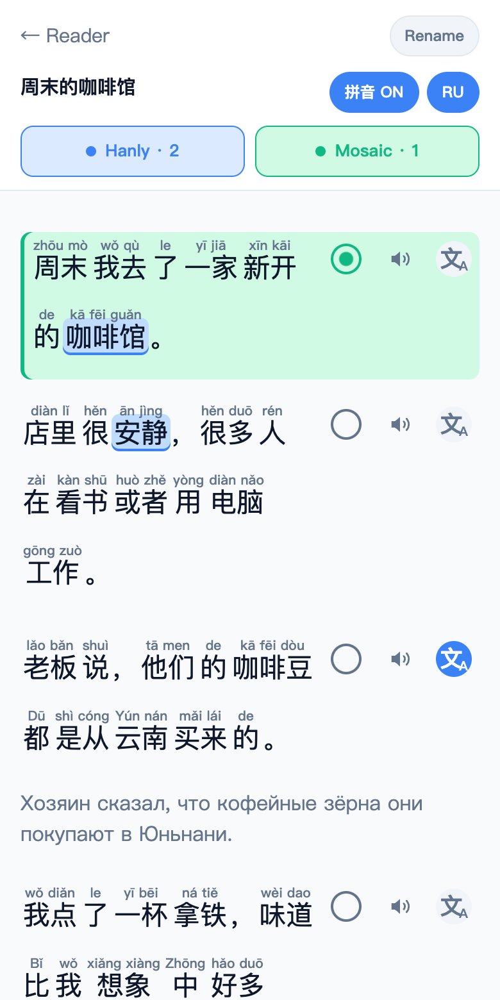
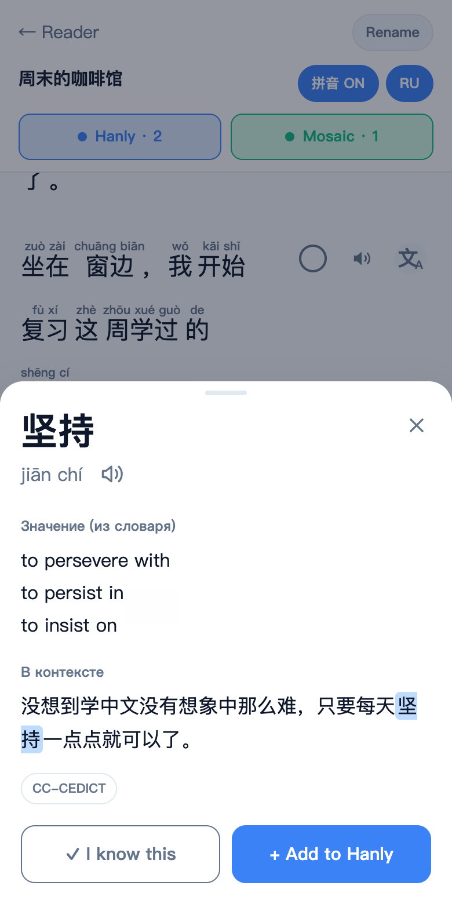
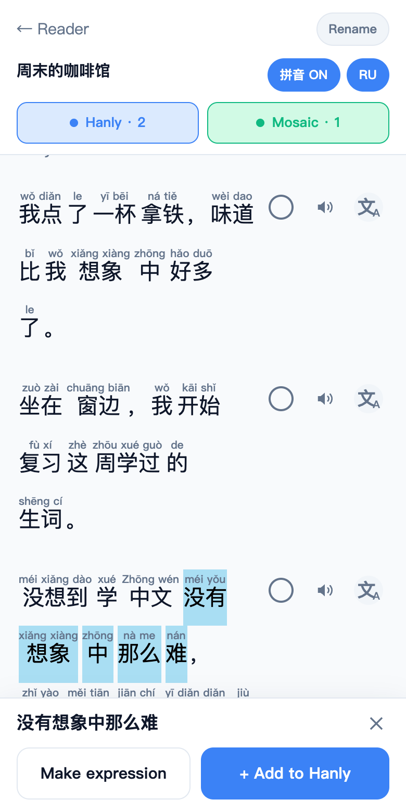
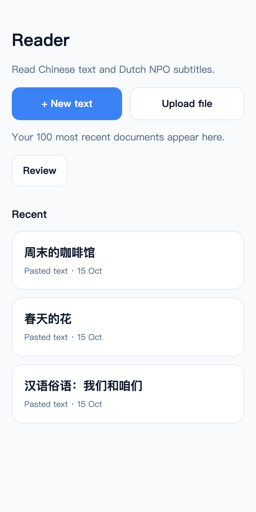
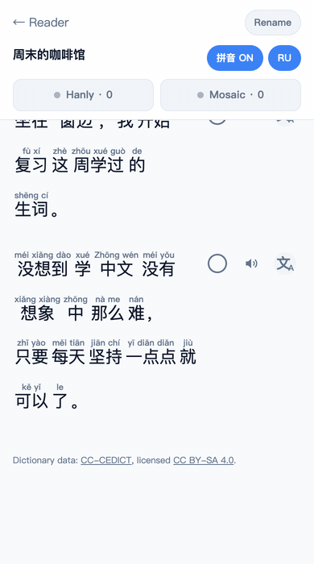
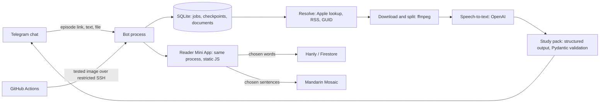

# Apple Podcast Transcriber & Study Bot

[](https://github.com/testprogmath/apple-podcast-transcriber/actions/workflows/ci.yml)

A private Telegram bot for learning Mandarin from real podcasts. Send it an Apple Podcasts episode and it returns a faithful transcript and a validated study pack. A Reader Mini App then lets you read any transcript or Chinese text with pinyin and dictionary meanings, and send the words and sentences you want to keep to two flashcard apps, Hanly and Mandarin Mosaic.

It is built for one person, a Mandarin learner whose native language is Russian, and serves only the configured Telegram user.

<table>
  <tr>
    <td width="25%"></td>
    <td width="25%"></td>
    <td width="25%"></td>
    <td width="25%"></td>
  </tr>
  <tr>
    <td>Pinyin, sentence translation, Hanly and Mosaic baskets</td>
    <td>Word card: pinyin, Russian meanings, the sentence it came from</td>
    <td>Select any phrase: make it one expression, or send it to Hanly</td>
    <td>Library of transcripts, pasted text and files</td>
  </tr>
</table>

<p align="center">
  
  <br>
  <sub>Three automatic words, 就 · 可以 · 了, become one expression with its own pinyin and dictionary meaning.</sub>
</p>

Screenshots come from a local Reader with the real CC-CEDICT and 大БКРС dictionaries and an original sample text. The interface speaks Russian because its one user does.

## What it does

- **Transcribes an episode faithfully.** Resolves an Apple Podcasts link to the exact RSS item, checks and splits the audio with ffmpeg, and transcribes it chunk by chunk with OpenAI speech-to-text. The transcript is never rewritten afterwards.
- **Builds a Mandarin study pack.** A reading version with tone-mark pinyin, a Russian translation, curated vocabulary, patterns and cultural notes, and CSV files for Hanly and Mandarin Mosaic. Other languages get a transcript and a vocabulary list.
- **Reads anything in a Mini App.** Transcripts, pasted text, `.txt`/`.md` files, SRT subtitles and Dutch NPO Start subtitles open in the same Reader. Chinese is segmented into tappable words with pinyin, meanings, pronunciation and per-sentence translations. Sentences from a podcast can play the original audio.
- **Lets you correct the segmentation.** Long-press to select a phrase across several words, then make it a single custom expression or send it straight to Hanly.
- **Uploads only what you choose.** Words go to a Hanly collection with a study note from their sentence; sentences go to a Mandarin Mosaic pack. Both baskets stay local until you press upload.
- **Reviews Dutch vocabulary.** Saved Dutch words and sentences feed a Review mode built on their original contexts.

## How it fits together



Python 3.12, SQLite, ffmpeg, the official OpenAI SDK, python-telegram-bot with long polling, jieba and pypinyin, CC-CEDICT, and a Mini App in plain JavaScript with no build step. One Docker container on one server. CI runs 1,044 Python tests and five frontend suites, then deploys `main`.

## Decisions worth reading

Four problems found in production, and how each was traced, are written up in [docs/engineering-notes.md](docs/engineering-notes.md).

**The transcript is the source of truth.** The study stage derives everything from the saved transcript and never edits it. Suspected speech-recognition errors appear as suggestions with a reason, never as silent replacements. Quotations and flashcard sentences are picked by segment ID from a deterministic catalogue of the transcript, so the model cannot paraphrase a quote. See [docs/study-pack.md](docs/study-pack.md).

**Model output is checked, then retried or dropped.** Each study response must cover its source blocks exactly once, in order, keeping every Chinese character. A "translation" that only repeats the Chinese source fails validation and the chunk is retried.

**No blind retries of paid calls.** Jobs and stage checkpoints live in SQLite. After a restart, finished speech chunks and study requests are reused. A request whose outcome is unknown waits for an explicit `/retry`, because it may already have been billed, and automatic SDK retries are disabled. See [docs/pipeline.md](docs/pipeline.md).

**Uploads are idempotent against APIs that are not.** Collection UUIDs and exact payloads are committed to SQLite before the first network call, so a retry re-sends the same identifiers instead of creating duplicates. Firestore writes carry an `updateTime` precondition, retry a bounded number of times on conflict, and report success only after a read-back. An HTTP 200 on its own does not count as success. See [docs/integrations.md](docs/integrations.md).

**Your own edits win.** A note the bot wrote to a flashcard is replaced only while it is byte-identical to what the bot last wrote. Edit it in the app and the bot leaves it alone and says so.

**Segmentation is a scored search, and the reader can overrule it.** Chinese is split by comparing whole paths through jieba and CC-CEDICT candidates, so a weak dictionary entry cannot swallow two real words. A reader's own expression is stored as an exact span of one sentence, counted in code points, and applied only while that text still matches. See [docs/reader.md](docs/reader.md).

**The browser holds no credentials.** The Mini App talks only to this backend. Every request is authenticated with Telegram's init-data HMAC, sentences are addressed by ID, and the backend checks every submitted word or span against the stored source before using it. See [docs/reader.md](docs/reader.md).

**Deploys are the tested commit, with a way back.** CI builds the exact commit that passed, sends it through a restricted SSH command, drains the worker, backs up SQLite, checks readiness, rolls back an unhealthy image, and prunes old release images once the new one is live. See [docs/deployment.md](docs/deployment.md).

## Try it

The resolver and the test suites need no credentials and make no paid calls:

```sh
brew install python@3.12 ffmpeg
python3.12 -m venv .venv
source .venv/bin/activate
python -m pip install -r requirements.lock -e '.[test]'
python -m podcast_bot resolve "https://podcasts.apple.com/nl/podcast/id1490732024?i=1000789324203"
python -m pytest -q
node tests/frontend/app.test.js
```

`resolve` fetches public Apple and RSS metadata only, with no audio download, and prints JSON in the shape of [`docs/resolver-example.json`](docs/resolver-example.json). The tests block unexpected network access and mock OpenAI, Telegram, Mandarin Mosaic and Firebase.

Running the bot itself needs a Telegram bot token, your numeric Telegram user ID and an OpenAI API key. Follow [docs/setup.md](docs/setup.md).

## Security and limitations

Only the configured Telegram user ID in a private chat is accepted. Other users are ignored before processing. Credentials, token files, audio, data and deployment notes are excluded from Git, and credentials and audio are excluded from the Docker build context.

Public HTTP and redirect checks, bounded downloads, local-only ffmpeg protocols, safe filenames, secret-redacted logging and a process lock protect this personal bot. It is not a hardened multi-tenant fetch service; DNS resolution is not pinned against rebinding.

Apple may omit episodes outside the latest 200, and RSS feeds may drop entries. Subscriber-only and DRM content is unsupported. Pinyin, translation quality and pedagogical usefulness remain model or dictionary judgements, even though schema, source and order checks are enforced.

## Licence

The application code is available under the [PolyForm Strict License 1.0.0](LICENSE). You may read it and run it for any noncommercial purpose, such as personal study or a hobby project. You may not change it, build new work on it or redistribute it.

Dictionary data keeps its own licences. CC-CEDICT and the Dutch Wiktionary extract are CC BY-SA 4.0, with attribution in [`dictionary/`](dictionary/). The 大БКРС Russian dictionary is third-party data and is not part of this repository.

## Documentation

| Topic | File |
| --- | --- |
| Every Telegram command, MP3 downloads, YouTube and SRT subtitles | [docs/commands.md](docs/commands.md) |
| Study pack contents, language rules, validation of long transcripts | [docs/study-pack.md](docs/study-pack.md) |
| Reader Mini App: baskets, dictionaries, translations, custom expressions, library | [docs/reader.md](docs/reader.md) |
| Original podcast audio for Reader sentences | [docs/reader-audio.md](docs/reader-audio.md) |
| Dutch language tools and NPO Start subtitles | [docs/reader-language-tools.md](docs/reader-language-tools.md), [docs/reader-npo.md](docs/reader-npo.md) |
| Review mode | [docs/reader-review.md](docs/reader-review.md) |
| Episode resolution, transcription, caching and billing | [docs/pipeline.md](docs/pipeline.md) |
| Hanly and Mandarin Mosaic integrations | [docs/integrations.md](docs/integrations.md) |
| Installation and configuration | [docs/setup.md](docs/setup.md) |
| Deployment, rollback and the release helper | [docs/deployment.md](docs/deployment.md) |
| Development, CI and dependency updates | [docs/development.md](docs/development.md) |
| Problems found in production and how they were traced | [docs/engineering-notes.md](docs/engineering-notes.md) |
